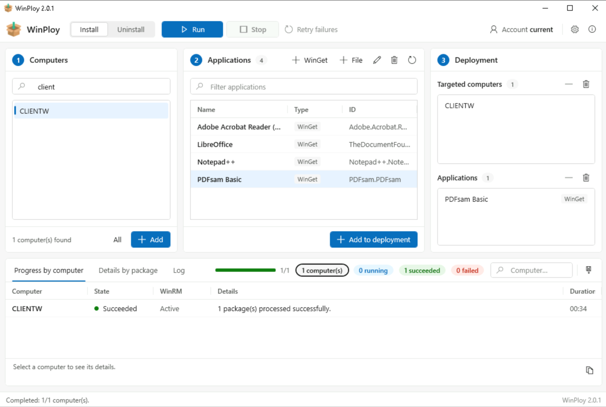

# WinPloy

[Français](README.md) · **English**

Push an application to a batch of Windows computers, on demand, from an admin workstation.
Windows desktop application (C# .NET 8 + WPF), with an English and a French interface.

Pick computers from Active Directory, pick WinGet applications or your own packages, click **Run**:
WinPloy opens a WinRM session on each computer, installs or uninstalls, and shows progress computer by
computer.

A one-off installation tool, not fleet management: no agent on the computers, no server to set up,
nothing to prepare in advance. See [One-off installation](#one-off-installation).



*The three steps from left to right — choose the computers, choose the applications, run — and the
progress at the bottom: state per computer, details per package and log. (Screenshot of the French
interface.)*

- **WinGet applications**: installed from the target computer's `winget` source, as SYSTEM.
- **Custom packages**: an `.msi` or a script (`ps1`, `bat`, `cmd`, `exe`) stored on a share.
  The script's folder is copied to the computer, run, then deleted. By default the copy goes through the
  WinRM session, so the target computer never needs access to the share.

---

## Features

| | |
|---|---|
| **Computers** | Active Directory search by name (partial, `*` wildcard) across the whole domain, without RSAT |
| **Catalogue** | JSON file shared between administrators, editable from the interface |
| **WinGet** | Online ID lookup from the add window — WinGet is not required on the admin workstation |
| **Custom** | `.msi` run with `msiexec /i` (or `/x`) `/qn /norestart`, or a script run either under the WinRM session account or as `NT AUTHORITY\SYSTEM` |
| **Execution** | Mixed WinGet + custom selection, computers processed in parallel (1 to 200), interface never blocked |
| **Progress** | State per computer, details per package, log, filters, stop during an operation, retry failures only |
| **Traceability** | CSV export of the results, local history, `gui.log` log file |
| **Integrity** | SHA-256 hash of a package folder frozen in the catalogue, checked before each deployment |
| **Transfer** | Hash-addressed cache on the target computer and compressed chunks, or SMB copy pulled by the computer |
| **WinRM** | Configurable port and HTTPS; `TrustedHosts` left untouched as long as Kerberos is enough |
| **Language** | English or French interface, following Windows or chosen in the settings |

## One-off installation

"Install this application on these twelve computers, now." That is the need WinPloy covers, and that is
all it covers. Unzip, launch, choose the computers, choose the applications, run, read the result.
Nothing to install on the admin workstation, nothing to deploy on the targets, nothing to prepare in
advance, nothing running between two operations.

This simplicity is the goal, not a step towards something else. WinPloy therefore does not manage the
state of a fleet: no inventory, no compliance, no remediation, no scheduling, no automatic updates.
Intune, SCCM, Action1, PDQ Deploy, WAPT or Chocolatey pushed by GPO do that job, and do it better — but
bringing them in to put an application on a few computers is out of proportion, when you have them.

## Requirements

**Admin workstation**

- Windows 10 or 11, domain member.
- .NET 8 Desktop Runtime, or a self-contained build (see [Building](#building)).
- Run as administrator: requested at launch by the application manifest.
- Read/write access to the catalogue, read access to the custom package files.
- The WinRM client's `TrustedHosts` is not modified — see [Trusted hosts](#trusted-hosts).
- Optional: HTTPS access to `api.winstall.app` for the WinGet ID lookup. Without it, the ID is typed by
  hand and the window offers the `https://winget.run/` link to copy.

**Target computers**

- WinRM enabled and reachable on the configured port — 5985 for HTTP by default, 5986 for HTTPS (GPO
  recommended). WinPloy never configures WinRM or the targets' firewall: the steps, by GPO or by hand,
  are in [Enable WinRM on the target computers](docs/ENABLE-WINRM.md).
- WinGet (App Installer) present for WinGet packages.
- In SMB transfer mode only: read access to the repository share from the target computer.

## Installation

Download the `WinPloy-<version>-win-x64.zip` archive from the [latest release](../../releases/latest),
unzip it wherever you like, then launch `WinPloy.exe`: elevation to administrator is requested
automatically. The .NET runtime is included in the archive, there is nothing else to install.

Since the executable is not signed, Windows SmartScreen shows a warning on first launch:
"More info" then "Run anyway".

## Building

To build it yourself, the .NET 8 SDK (or newer) is required.

```bash
dotnet build WinPloy.sln -c Release
dotnet test WinPloy.sln
```

The file reception protocol has its own check, which needs neither the network nor a domain:

```bash
pwsh -NoProfile -File tests/Remote/ReceiveFiles.Tests.ps1
```

Publish to a folder, .NET runtime included — nothing to install on the admin workstation:

```bash
dotnet publish src/WinPloy/WinPloy.csproj -c Release -r win-x64 --self-contained true -o publish
```

Then launch `publish\WinPloy.exe`.

## Usage

1. **Settings** (gear icon): on first launch, enter the UNC path of the shared catalogue, for example
   `\\server\depot\catalogue.json`. The folder of this file is the root of the custom package
   repository. Adjust if needed the time limit per package (1 to 240 min, 30 by default), the number of
   computers processed in parallel (1 to 200, 10 by default), the WinRM port of your computers and the
   transfer mode — see [WinRM and transfer settings](#winrm-and-transfer-settings).
2. **Account**: by default the WinRM session uses the current account. The "Account" button lets you
   provide other administrator credentials.
3. **Step 1 — Computers**: search for computers in AD, add them to the list of targeted computers.
4. **Step 2 — Applications**: add a WinGet application or a custom package to the catalogue, then add it
   to the deployment.
5. **Install / Uninstall**, then **Run**. Progress is shown at the bottom: state per computer, details
   per package, log. "Retry failures" runs the operation again on the failed computers only.

### Interface language

WinPloy follows the Windows display language: French on a French Windows, English otherwise. The
**Language** field in the settings forces English or French; the choice is applied the next time
WinPloy starts.

Messages returned by the target computers follow the interface language too. Data files keep their
format whatever the language: the column names of the CSV export and of the history (`Ordinateur`,
`Paquet`, `Statut`…) and the status values written there (`OK`, `ECHEC`, `ARRÊTÉ`) stay the same, so that
existing exports and scripts that read them keep working.

### Custom packages

Each package must live in **its own subfolder** of the repository: the whole folder is copied to the
target computer, so a script placed at the root of the repository would copy the whole repository there.
WinPloy refuses that case.

```
\\server\depot\
├── catalogue.json
├── MyApp\
│   ├── setup.msi
│   └── uninstall.ps1
└── OtherApp\
    └── install.ps1
```

A package is considered successful if the exit code is `0` or `3010` (restart required).

On the target computer, the folder is rebuilt under `C:\Windows\Temp\WinPloy`, in a folder whose
permission inheritance is cut: only `NT AUTHORITY\SYSTEM` and the Administrators group have access.
Without this, since `C:\Windows\Temp` is writable by standard users, a user of the computer could replace
a script just before it runs as SYSTEM. A folder created beforehand by someone else, or turned into a
link, is deleted and recreated.

### Package integrity check

A package folder is copied then run on the computer, often as SYSTEM: whoever can write to the repository
can run code on every computer. The **"Check the folder's SHA-256 hash"** box in the package window
freezes the expected content of the folder in the catalogue, file by file. Before each deployment,
WinPloy recomputes the hashes and refuses the package if a file was modified, removed or added.

```json
"Files": {
  "setup.msi":    "9f86d081884c7d659a2feaa0c55ad015a3bf4f1b2b0b822cd15d6c15b0f00a08",
  "install.ps1":  "60303ae22b998861bce3b28f33eec1be758a213c86c93c076dbe9f558c11c752"
}
```

After each intended update of the package, recompute the hash from the same window — otherwise the
deployment will be refused, which is the intended behaviour. The check requires the install and
uninstall scripts to live in the same folder, since the hash covers one folder.

A package without `Files` is not checked: catalogues written before this version work as they are, and
both forms can live side by side in the same file.

### WinRM and transfer settings

| Setting | Effect |
|---|---|
| **Port** | Port of the targets' WinRM service. 5985 for HTTP, 5986 for HTTPS; the port follows the HTTPS box as long as it keeps the other protocol's default value |
| **HTTPS** | WinRM session over SSL, for fleets where port 5985 is closed by GPO |
| **Certificate that cannot be validated** | Accepts a self-signed certificate or one with a different name. No effect over HTTP, weakens the authentication of the target computer: keep it for fleets without a certificate authority |
| **WinRM transfer** *(default)* | The folder goes through the admin workstation chunk by chunk. The target computer never accesses the share |
| **SMB transfer** | The target computer maps the share with the provided credentials and copies the folder itself |

In WinRM mode, each file is identified by its hash and cached on the target computer under
`C:\Windows\Temp\WinPloy\cache` (purged after 30 days): a redeployed package, a retry of the failures or
two packages sharing a file no longer cost anything on the network. Chunks are compressed when that
reduces their size, and the hash is checked again on the computer before each use of the cache — a
modified entry is requested again, never run.

In SMB mode, the file goes from the file server to the computer in a single hop, which moves the load from
the admin workstation to the file server: this is the mode to choose for a large fleet or big installers.
It requires two things — explicit credentials ("Account" button), because the WinRM session has no network
identity to present to the file server, and read access to the share from the target computer. The hash
is then checked on the computer, after the copy, since it is the one that read the repository.

Above 50 computers in parallel, the interface warns that the admin workstation becomes the bottleneck in
WinRM transfer; the upper limit is 200.

### Trusted hosts

On a domain, `TrustedHosts` is useless: WinRM authenticates with Kerberos, and a domain-joined computer,
reached by its name or FQDN, carries the trust by itself. The list only becomes necessary when Kerberos
cannot apply and authentication falls back to NTLM — connection by IP address, local account, computer
outside the domain or the forest.

WinPloy therefore leaves it alone, and the authentication mechanism is chosen so that the question does
not come up:

| Target and account | Mechanism | `TrustedHosts` |
|---|---|---|
| Named computer, current account | `Default`, so Kerberos | never touched |
| Named computer, domain account (`DOMAIN\u`, `u@domain`) | `Negotiate`, which chooses Kerberos | never touched |
| Named computer, local account (`COMPUTER\u`, `.\u`) or bare account name | `Negotiate`, so NTLM | added if opening fails |
| Target designated by its IP address | no SPN, Kerberos impossible | added if opening fails |

The first case deserved this table: forcing `Negotiate` on the current account is enough to get the
session refused over HTTP — *"default credentials with Negotiate over HTTP can be used only if the target
machine is part of the TrustedHosts list"* — and WinPloy used to invent a need for trusted hosts it did
not have.

A computer is therefore only added when WinPloy knows, from the target and the account, that Kerberos
cannot apply; the session is then retried once, and the original refusal goes to the log. The WinRM
client's error message decides nothing: it attaches the same help text mentioning `TrustedHosts` to
failures that have nothing to do with the list. What was added is removed at the end of the operation:
entries already present are never taken back, and a `TrustedHosts` set to `*` is left intact.

In a properly configured domain, the list therefore stays empty from start to finish, and the local WinRM
service is not even started — it is only needed to read and write this configuration, never for outgoing
sessions.

If your fleet really requires non-Kerberos targets, it is better to push `TrustedHosts` by GPO
(*Computer Configuration > Administrative Templates > Windows Components > Windows Remote Management
(WinRM) > WinRM Client*) and to switch the listeners to HTTPS with a real certificate: encryption becomes
the protection, rather than the list. A GPO that enforces `TrustedHosts` prevents any local change —
WinPloy detects it and reports it in the log instead of failing silently.

### Shared catalogue

The catalogue is a plain JSON array, editable from the interface or by hand:

```json
[
  { "Type": "WinGet", "Id": "Git.Git", "Name": "Git" },
  {
    "Type": "Custom",
    "Id": "custom:MyApp",
    "Name": "MyApp",
    "InstallScript": "\\\\server\\depot\\MyApp\\setup.msi",
    "UninstallScript": "\\\\server\\depot\\MyApp\\uninstall.ps1",
    "RunAs": "System",
    "Files": { "setup.msi": "9f86d081…", "uninstall.ps1": "60303ae2…" }
  }
]
```

The type is deduced from the ID: the `custom:` prefix marks a custom package. `Files` is optional: see
[Package integrity check](#package-integrity-check).

## Local files

In `%ProgramData%\WinPloy`:

| File | Content |
|---|---|
| `config.json` | Settings of the admin workstation, interface language included |
| `historique-deploiements.json` | History of the results |
| `gui.log` | Application log (rotated at 5 MB) |

On each target computer, in `C:\Windows\Temp\WinPloy` — folder reserved for SYSTEM and administrators:

| | |
|---|---|
| `cache\` | Package files, named after their SHA-256 hash. Purged after 30 days |
| `stage_<guid>\` | Folder of a package while it runs, deleted right after |

## Repository layout

```
WinPloy.sln
Directory.Build.props          Properties shared by the three projects (TFM, version, nullable, languages)
src/WinPloy.Core/              Library: models, services, WinRM deployment engine
  Properties/Strings*.resx       Messages: English (neutral) and French
  Deployment/Remote/           Scripts run on the target computer, embedded in the assembly
    RemoteAction.ps1             Installing and uninstalling packages
    NewWorkDir.ps1               Working folder with restricted permissions (SYSTEM, Administrators)
    ReceiveFiles.ps1             Receiving chunks and hash-addressed cache
    PullFromShare.ps1            Copy pulled by the computer from the share (SMB mode)
src/WinPloy/                   WPF application: windows, ViewModel, theme
  Properties/Strings*.resx       Interface texts: English (neutral) and French
tests/WinPloy.Tests/           xUnit unit tests, without network or domain
tests/Remote/                  Check of the reception protocol, run by PowerShell
assets/                        Application icon, used at build time
docs/ENABLE-WINRM.md           Preparing the target computers: WinRM by GPO or by hand
docs/ACTIVER-WINRM.md          Same, in French
docs/PLAN-CONVERSION.md        Plan of the PowerShell → C# conversion (French)
docs/images/                   README screenshots
legacy/Winploy-GUI.ps1         Original PowerShell script (v1.0.0), kept for reference
```

### Translating

Texts live in `Properties/Strings.resx` (English, neutral language) and `Properties/Strings.fr.resx`
(French) of each project. A new language is a new `Strings.<code>.resx` file next to them, its code added
to `SatelliteResourceLanguages` in `Directory.Build.props` and to `AppSettings.SupportedLanguages`.
The `LocalizationTests` tests check that every key is translated with the same `{0}` placeholders.

## History

WinPloy 1.0.0 was a single PowerShell + WinForms script,
[`legacy/Winploy-GUI.ps1`](legacy/Winploy-GUI.ps1). Version 2.0 is a complete rewrite in C# .NET 8 +
WPF, described (in French) in [docs/PLAN-CONVERSION.md](docs/PLAN-CONVERSION.md).

Differences from the PowerShell version:

- Native LDAP queries instead of the ActiveDirectory module: RSAT no longer needed.
- One computer = one task in the process, instead of a PowerShell job in a separate process.
- WinPloy's own credentials window instead of `Get-Credential`.
- Custom packages in `.msi` format and online lookup of WinGet IDs.
- New history dates are in ISO 8601 format.
- English interface, alongside the French one.

The catalogue format has not changed: both versions can use it at the same time during the transition.

## License

Distributed under the [Apache 2.0](LICENSE) license — Copyright 2026 Constant Segretain.

---

Author: Constant Segretain
